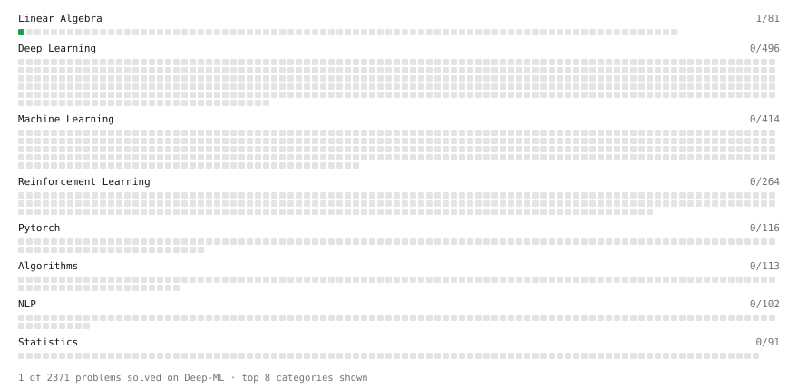

# Deep-ML

My machine learning practice from [Deep-ML](https://www.deep-ml.com). Every solution here was written by hand.

**3** solved · 2 problems · 0 labs · 1 math

[**Browse the interactive portfolio**](https://artemis-bouzaki.github.io/deep-ml/) to replay this filling in over time.

## Problems

| | Difficulty | Solved | |
| --- | --- | --- | --- |
| [Matrix-Vector Dot Product](https://www.deep-ml.com/problems/1) | easy | 2026-11-20 | [solution](problems/0001-matrix-vector-dot-product) |
| [Transpose of a Matrix](https://www.deep-ml.com/problems/2) | easy | 2026-11-20 | [solution](problems/0002-transpose-of-a-matrix) |

## Math

| | Difficulty | Solved | |
| --- | --- | --- | --- |
| [Sampling and Aliasing: Why You Blur Before You Downsample](https://www.deep-ml.com/math-problems/566) | medium | 2026-11-20 | [solution](math/0566-sampling-and-aliasing-why-you-blur-before-you-downsample) |

---

_This file is regenerated by Deep-ML on every push._
